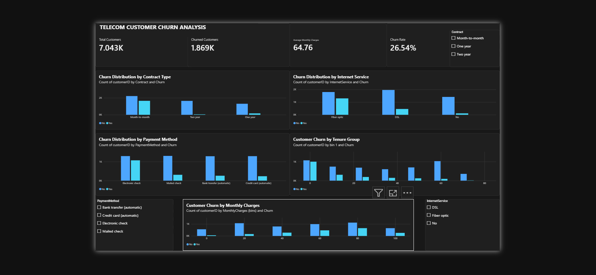

# Telecom Customer Churn Analysis

An end-to-end Data Analytics project that explores customer churn patterns in the telecommunications industry using Python, SQL, PostgreSQL and Power BI.

## Project Overview

Customer churn occurs when customers discontinue a company's services. Retaining existing customers is essential for business growth and profitability.

This project analyzes customer data to identify churn patterns, understand factors associated with customer attrition and derive actionable business insights that can support customer retention strategies.

## Objectives

- Analyze customer demographics and service usage.
- Identify patterns among customers who discontinued services.
- Examine the relationship between contracts, tenure, payment methods and churn.
- Perform SQL-based business analysis.
- Develop an interactive Power BI dashboard.
- Generate data-driven business recommendations.

## Tech Stack

| Tool | Purpose |
|---|---|
| Python | Data cleaning and exploratory data analysis |
| Pandas, NumPy | Data manipulation |
| Matplotlib, Seaborn | Data visualization |
| PostgreSQL | Database management |
| SQL | Business analysis and querying |
| Power BI | Interactive dashboard development |
| Jupyter Notebook | Python development environment |
| Git & GitHub | Version control |

## Dataset

- Dataset: Telco Customer Churn
- File: `WA_Fn-UseC_-Telco-Customer-Churn.csv`
- Records: 7,043 customers
- Attributes: 21 columns
- Target variable: `Churn`

The dataset contains customer demographics, tenure, subscribed services, contract details, payment methods, and billing information.

## Project Workflow

1. **Data Exploration and Cleaning**
   - Inspected dataset structure and data types.
   - Identified missing and invalid values.
   - Converted TotalCharges into a numeric format.
   - Checked for duplicate records.

2. **Exploratory Data Analysis using Python**
   - Analyzed customer churn distribution.
   - Explored customer demographics and service subscriptions.
   - Examined tenure and monthly charges.
   - Created visualizations to identify churn patterns.

3. **SQL Analysis using PostgreSQL**
   - Imported customer data into PostgreSQL.
   - Performed customer segmentation and aggregation.
   - Analyzed churn across contract types and payment methods.
   - Investigated service-related churn patterns.
   - Evaluated tenure and monthly charge groups.

4. **Power BI Dashboard**
   - Developed KPI cards for key business metrics.
   - Created five analytical charts.
   - Added interactive slicers for Contract, Internet Service, and Payment Method.

## Key Business Findings

- Overall customer churn rate: **26.54%**.
- Month-to-month contracts have substantially higher churn than long-term contracts.
- Fiber Optic customers show higher churn than DSL customers.
- Electronic Check users have the highest churn rate among payment methods.
- Customers with shorter tenure are more likely to discontinue services.
- Higher monthly charges are associated with higher churn.
- Customers without services such as Tech Support and Online Security exhibit higher churn.

## Power BI Dashboard



The dashboard presents:
- Total Customers
- Churned Customers
- Average Monthly Charges
- Overall Churn Rate
- Churn by Contract Type
- Churn by Internet Service
- Churn by Payment Method
- Churn by Tenure Group
- Churn by Monthly Charges

## Repository Structure

```text
Telecom-Customer-Churn-Analysis/
│
├── WA_Fn-UseC_-Telco-Customer-Churn.csv
├── Telecom_Customer_Churn_Analysis.ipynb
├── telecom_churn_analysis.sql
├── SQL_Business_Insights.txt
├── Telecom_Customer_Churn_Dashboard.pbix
├── README.md
└── .gitignore
```

## How to Run the Project

1. Clone the repository.
2. Install the required Python libraries.
3. Open the Jupyter Notebook.
4. Execute the notebook cells to explore the dataset.
5. Import the CSV dataset into PostgreSQL.
6. Execute the SQL queries.
7. Open the Power BI dashboard file to explore the visualizations.

## Skills Demonstrated

- Data Cleaning and Preprocessing
- Exploratory Data Analysis (EDA)
- Python Programming
- SQL Queries and Aggregations
- PostgreSQL Database Management
- Data Visualization
- Business Insights Generation
- Power BI Dashboard Development

## Conclusion

This project demonstrates an end-to-end data analytics workflow, transforming raw customer data into meaningful business insights through Python, SQL, PostgreSQL, and Power BI.

The findings can help telecommunications businesses understand customer attrition patterns and identify potential areas for improving customer retention.
